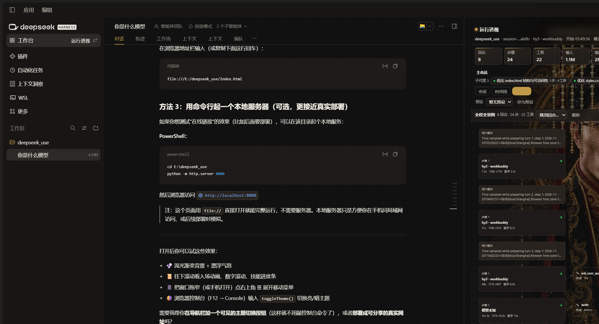

# 运行透视（Run Lens）

> DSH Desktop 工作台插件：把一段 agent 运行过程变成一张可以缩放、点击、下钻的图。左边保留原生对话，右边用**会话 / 时间线 / 全景图**三种视图查看整个过程。



**Run Lens** is a DSH Desktop workbench plugin that visualizes an entire agent run — turns, steps, model calls, tool calls, subagents (including nested levels) — as a single zoomable panorama, plus chat-style and timeline views, with on-demand full content, smooth reasoning playback, and a heuristic divergence check.

## 截图


> 截图来自 DSH Desktop 0.13.1 + 运行透视 0.5.6（Windows 11）。左侧是宿主原生对话，右侧是工作台的「全景图」视图。

## 为什么用它

- **整段会话一张图**：不再按「回合 1 / 2 / 3…」切开，所有回合串成一条连续主链，工具调用作为右侧分支。
- **多 agent 同图**：主会话与子代理（含嵌套子代理）默认全部画进同一张图；子代理节点点击即可查看摘要，也可「单独打开」进入它自己的完整视图。
- **想知道模型到底做了什么**：每步的思考、输出、完整参数与返回、耗时、首字延迟、token 用量、错误，都在节点详情里按需加载。
- **只读、本地**：不修改会话、不激活 Agent、不上传任何内容。

## 功能

- **三种视图**
  - **会话**：像聊天一样读每回合的用户提问与助手输出，思考过程可折叠，工具 chips 可跳到全景图对应节点。
  - **时间线**：可搜索、可按「全部 / 模型 / 工具 / 错误」筛选的步骤列表，支持全部展开/收起、自动跟随最新。
  - **全景图（默认）**：所有回合串成一张连续图；工具节点连接子代理时显示为 🤖 子代理节点；展开的子代理运行链里若再调用子代理，会继续向右并列展开（最多 3 层）。
- **子流程详情与跳转**：点击节点在下方面板查看摘要与完整内容；「加载完整内容」按需拉取；支持复制；时间线可跳到全景图对应节点。
- **丝滑思考**：流式思考内容逐字呈现，生成中实时标记。
- **思路偏离检查**：根据重复调用、工具失败、思考/输出比例、用户关键词覆盖等启发式给出提示，并展示「思考 vs 输出」双栏对照（仅供参考）。
- **交互**：缩放（适应宽度 / ±）、回合跳转、定位最新、搜索筛选、复制。
- **键盘快捷键**（面板聚焦后）：`1–3` 切换视图，`f` 切换自动跟随，`e` 时间线展开/收起，`Esc` 关闭详情。

## 安装

要求 **DSH Desktop 0.13.1 或更高版本**（该版本起支持本地安装的工作台）。

### 从 GitHub Release 安装

1. 下载最新安装包：[`dsh-desktop-run-lens.tgz`](https://github.com/dadawre/dsh-desktop-run-lens/releases/latest/download/dsh-desktop-run-lens.tgz)
2. 在 DSH Desktop 的插件 / 工作台安装入口选择这个 tgz 安装。
3. 安装后重启一次 DSH Desktop（应用菜单 → 重启，或 `Ctrl+Shift+R`），服务端接口与面板才会生效；只刷新页面不够。
4. 打开左侧栏「工作台」切换区，选择「运行透视」。

### 从源码安装（开发）

```bash
git clone https://github.com/dadawre/dsh-desktop-run-lens.git
cd dsh-desktop-run-lens
pnpm pack
# 安装生成的 dsh-desktop-run-lens-<version>.tgz，然后重启 DSH Desktop
```

仓库根目录同时是一个可直接安装的 DSH 工作台包（无需构建步骤）。

### 工作台市场

工作台市场收录流程进行中；上架后会支持在工作台市场「已安装 / 发现」中直接安装。

## 使用

- 打开后默认进入**全景图**。顶部显示运行状态、模型、`回合 / 步骤 / 工具` 数量与「已并入 N 个子代理」。
- **滚轮 / 按钮**缩放；「跳到回合…」快速定位；「最新」跳到当前运行位置。
- **点击节点**查看详情：模型节点有输出、思考、请求信息与 token；工具节点有完整参数、返回、错误与元数据；子代理节点有摘要与「单独打开」。
- 顶部切换到**时间线**或**会话**视图；时间线里可以用搜索与筛选快速定位错误或某个工具。
- 子代理默认全部并入全景图，无需展开；点击 🤖 节点只查看详情，不会收起子图。

## 数据与隐私

插件只读本机会话事件：

- 活动会话：`ctx.sessions.get(sessionId).snapshotEvents()`
- 已持久化 / 非活动会话（含子代理会话）：`ctx.sessionPersistence.open(sessionId, 'read')` 后循环 `read(offset, 400)`，读完关闭句柄

面板通过三个同源接口读取聚合结果：

| 接口 | 用途 |
| --- | --- |
| `GET /api/dsh-desktop-run-lens/snapshot?sessionId=<id>` | 紧凑摘要（面板按运行状态轮询） |
| `GET /api/dsh-desktop-run-lens/detail?sessionId=<id>&turn=<n>&step=<n>` | 按需返回该步骤的完整输出、思考、参数与返回 |
| `GET /api/dsh-desktop-run-lens/subagents?sessionId=<id>` | 子代理目录、层级、状态与摘要 |

- 不写任何文件、不修改会话、不激活 Agent、不发起外部网络请求。
- 归属校验：若会话已绑定到其他工作台，本工作台拒绝读取该会话（HTTP 403）。
- 卸载插件不会删除用户的会话或任何数据；插件自身不保存业务数据。

## 工作原理

本仓库是一个 npm 包，同时也是 DSH bundle：

```
package.json          npm 元数据 + dsh.bundle / dsh.client 声明
cordis.patch.yml      DSH bundle 的 Cordis 补丁（insert 本插件）
dsh/index.js          服务端插件：注册 snapshot / detail / subagents 三个 GET 路由
lib/client.js         客户端面板：window.__ModuleLoader__.load 单文件模块，注册工作台
```

- 服务端聚合事件（`turn/*`、`step/*`、`assistant/*`、`tool/*`、`request/*`，载荷在 `event.data`，时间戳为 `event.time`）并通过同源 `/api` 路由提供。
- 客户端为构建好的单文件模块，通过 `ctx.desktopWorkbenches.register(...)` 注册工作台；所有视图在面板内部实现，不替换 Desktop 公共入口。
- 服务端入口不静态导入 `@deepseek-ai/*`，避免不同 profile 依赖树下的解析差异。

## 兼容性

- DSH Desktop：0.13.1 及以上（本地工作台支持从该版本开始）。
- 开发验证环境：Windows 11 + DSH Desktop 0.13.1（Harness 0.2.2-alpha.2）。
- 无构建步骤；客户端入口为纯 JS 单文件。

## 开发

```bash
# 语法检查（无需依赖）
node --check dsh/index.js
node --check lib/client.js

# 打包
pnpm pack
```

本地安装后修改代码：重新 `pnpm pack` 并安装，再重启一次 DSH Desktop。注意只重新加载页面不会替换已加载的服务端模块。

## 变更记录

见 [CHANGELOG.md](CHANGELOG.md)。当前版本 **0.5.6**。

## 许可

[MIT](LICENSE) © 2026 dadawre
